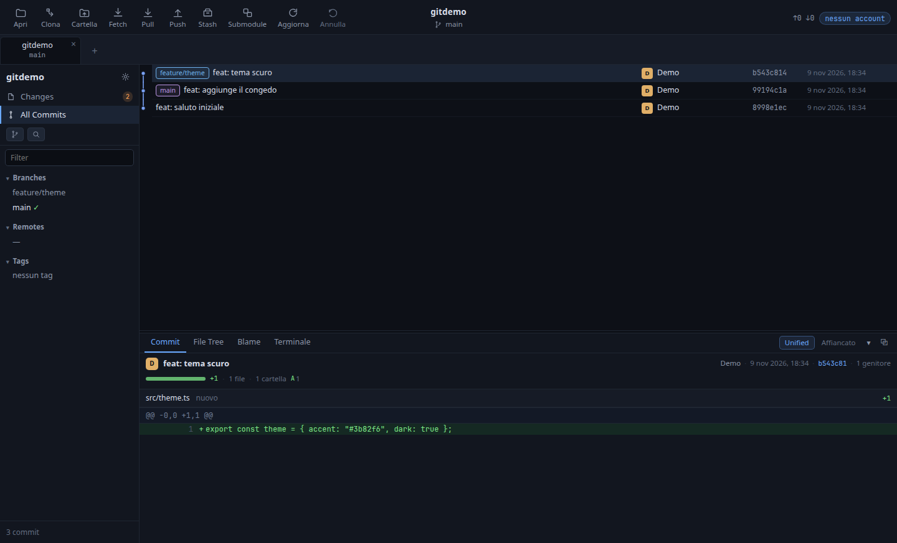
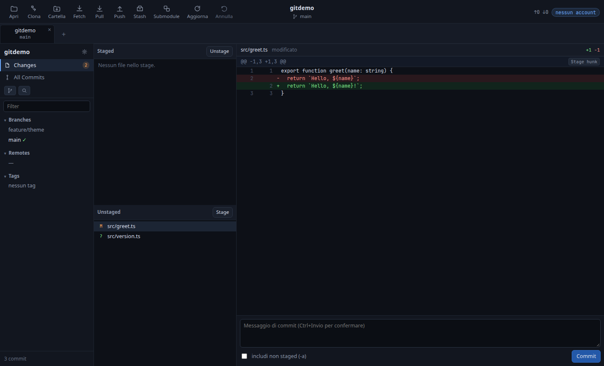

# GitHandler

[](https://github.com/emaxlele/githandler/actions/workflows/ci.yml)
[](LICENSE)
[](package.json)

**Linux-first** desktop Git client, TypeScript on Electron. It opens, **creates** or **clones** a
repository (from a URL or from a GitHub / GitLab / Gitea / Bitbucket account), shows history with a
graph, diffs, and covers the daily flow: stage (including partial), unstage, discard, commit, checkout
of a branch **or a commit**, undo, pull, push, stash, merge, rebase, cherry-pick and submodules. From
the repository you reach **the file and the folder** — reveal the location, open the file, save a
copy, open repository and commit in the browser, export HEAD as a zip — and the **token is taken where
it already is** (`gh`, credential helper) or **from the browser** with the OAuth device flow. Each
repository remembers which account to work with, **forks** sync with their original and **GitHub
Actions** are read, re-run and cancelled from the app. The same repository is readable by an AI agent
through an MCP server, off by default and enabled command by command.

The name: **`git`** first, because that is how a Git client is searched for, and **handler** — who
handles the repository. The project was called `gitcraft`, then for a few hours on 8 November 2026
`lanecraft` and `gitlattice`.

The code is original and clean-room: no code, string, icon or asset taken from other products.

Italiano: [README.md](README.md)

## Preview





## Status (v0.10)

| Feature                                                                              | Status         |
| ------------------------------------------------------------------------------------ | -------------- |
| Open repository                                                                      | ✅             |
| **Create repository** (`git init`, local identity)                                   | ✅             |
| **Clone from URL and from account** (4 providers)                                    | ✅             |
| **Welcome on start** (no automatic dialog)                                           | ✅             |
| **File and folder actions from the repository**                                      | ✅             |
| **Browser sign-in (OAuth device flow)**                                              | ✅             |
| **“Sign in” with the token already on the machine** (`gh`, credential helper)        | ✅             |
| **Account chosen per repository** (header chip)                                      | ✅             |
| **Fork: detect the original and sync**                                               | ✅             |
| **GitHub Actions**: runs, retry failed jobs, re-run, cancel                          | ✅             |
| **Repository files** (filterable list, browser)                                      | ✅             |
| **Export HEAD as a zip**                                                             | ✅             |
| History with swimlane graph, paginated (2,000/page)                                  | ✅             |
| Branches, remotes, tags with ahead/behind                                            | ✅             |
| File staging, unstage, discard                                                       | ✅             |
| **Partial staging by hunk and by line**                                              | ✅             |
| Unified and **side-by-side** diff with intra-line changes                            | ✅             |
| Commit (also `-a`), checkout of branch and commit, new branch                        | ✅             |
| Fetch                                                                                | ✅             |
| **Pull** (`--ff-only`) and **push** (never forced)                                   | ✅             |
| **Stash** (save selected files only, apply, pop, drop)                               | ✅             |
| **Merge, rebase, cherry-pick**, abort operation                                      | ✅             |
| **Pull request / merge request**: list and create from two branches                  | ✅             |
| **Conflicts resolved in the app** (per file and per hunk, "continue")                | ✅             |
| **Interface in Italian and English**                                                 | ✅             |
| **Command palette** (`Ctrl+K`) and documented shortcuts                              | ✅             |
| **Submodules** (list and update)                                                     | ✅             |
| **Integrated terminal** (in the active repository)                                   | ✅             |
| **Several repositories open at once** (tabs)                                         | ✅             |
| **Global undo** (commit, checkout, discard, merge)                                   | ✅             |
| **Recoverable untracked files** (Git objects)                                        | ✅             |
| **History search**: text, `author:`, `file:`, `regex:`, `change:`, `diff:`, `lines:` | ✅             |
| **Content search** in tracked files (`git grep`)                                     | ✅             |
| **Reflog** in the app and "go to commit" by SHA                                      | ✅             |
| **Pull request checks** (result and links)                                           | ✅             |
| **CI notifications from the system tray**                                            | ✅             |
| **Repository health**: diverged branches, old stashes, submodules, detached HEAD      | ✅             |
| **Network progress** (clone, fetch, pull, push)                                      | ✅             |
| **Themes** light / dark / OLED, density and text size                                | ✅             |
| **Automatic refresh** (`--watch`)                                                    | ✅             |
| **Blame in the UI** (virtualized panel)                                              | ✅             |
| **Resizable, collapsible, detachable panel**                                         | ✅             |
| **MCP server with configurable permissions**                                         | ✅             |
| Syntax highlighting (CodeMirror 6)                                                   | ⏳ milestone 2 |
| **`.deb`** (Electron included, `npm run deb`)                                        | ✅             |
| AppArmor profile in the package                                                      | ⏳ milestone 4 |

## Interface

The window follows the layout of established desktop Git clients, with light, dark or OLED
(dark or true black) themes, comfortable or compact density and three text sizes, chosen in
settings:

-   **Toolbar** with labelled actions (Open, Clone, Folder, Fetch, Pull, Push, Stash, Submodule,
    Refresh, Undo) and, in the middle, the repository and current branch. Above the history are the
    open repository tabs, with the × to close them and the `+` that opens the choice _Open / Create /
    Clone from URL / Clone from an account_.
-   **Tabs reopen by themselves**: on start the window restores the repositories of the last session,
    in the same order, and returns to the active one (`localStorage["githandler.sessions"]`). A path
    that no longer exists is skipped without stopping the others. `--repo <path>` opens that
    repository as well and makes it active.
-   **Welcome without a repository**: with no saved tabs the window opens no system dialog, it shows
    the four choices and the base folder from which dialogs and clones start. Closing the last tab
    returns there.
-   **Sidebar**: repository name, _Changes_ with a count, _All Commits_, a search filter and refs split
    into Branches / Remotes / Tags. The count hides at zero, is green when everything is staged and
    amber when something is left out.
-   **CI notifications without keeping the window in front**: the system tray icon has "Show
    GitHandler", "Check now", the notifications toggle and "Quit". When a workflow run of the active
    repository turns into a failure a notification arrives, **once**; the first check after startup
    is a snapshot and does not warn about the past. GitHub only, like the runs window.
-   **Reflog and a jump to any commit**: "Reflog…" lists the moves of HEAD (commit, checkout,
    reset, rebase) with selector, abbreviated SHA and date; "Go to the commit" opens that commit in
    the panel. "Go to commit by SHA…", from the palette, reaches any commit even outside the loaded
    history page. Neither changes the repository.
-   **Network progress**: clone, fetch, pull and push read Git `stderr` while they work and show in
    the toolbar the phase (receiving, resolving, sending), a bar and the percentage; on a fast
    connection the bar is not needed, but with a large repository you can see that something is
    happening.
-   **Search with a small language**: free text is literal and case-insensitive; `author:` and
    `file:` filter author and path; `regex:` searches the message with an extended regular
    expression, `change:` the commits where the number of occurrences of a text changed (`-S`),
    `diff:` the commits whose diff contains a matching line (`-G`), `lines:10,40:file` the history of
    that line range (`-L`, on the current branch). The syntax appears under the field when it opens.
-   **Content search** (`git grep`): a separate dialog searches tracked files, with literal text or
    a regular expression and a case-sensitivity switch; every result shows file, line and text, and
    opens in the system app. The list stops at 1,000 matches and says so.
-   **Repository health…** (command palette): a read-only check for diverged branches (commits both
    to send and to receive), local branches without upstream, stashes older than 30 days, submodules
    that are not clean and a detached HEAD. It changes nothing: it says what to look at.
-   **A single view for changes**: the _Changes_ entry in the sidebar brings them to the whole area,
    without history or lower panel: Staged and Unstaged lists, the diff and the commit box.
    _All Commits_ goes back to history.
-   **History** in five columns: swimlane graph, message with ref badges, author with initials avatar,
    short SHA, date. Click a branch or tag: the cursor moves to its commit. Right click a branch:
    checkout, merge, rebase, rename, delete, copy; on a commit: new branch from that point, merge,
    rebase, reset soft / mixed / hard, cherry-pick, copy SHA and message.
-   **Lower panel** with four tabs: `Commit` (a card with author — and committer, when different —
    subject, date, copyable SHA, parents and a one-line analysis: proportional bar between additions
    and deletions, `+N`/`−M`, files, folders, binaries and a count per status; below, the diff of the
    whole commit in a single scroll, up to 12 files and 4,000 lines), `File Tree` (tree of the commit
    or of the working tree, diff on the right, the only file-by-file view), `Blame` and `Terminal`.
    The handle above the panel resizes it, `▾` collapses it to the tab row and `⧉` opens it in a
    separate window: when that is closed, the panel returns to its place. While it is separate, a
    «Details ↗» chip in the toolbar brings that window to the front. Diff and tree scroll, with their
    height bound to the pane.

### Keyboard shortcuts

Every command has a name and a single place where it runs: the palette (`Ctrl+K`) searches them as
you type, the shortcuts call the same functions. `?` opens the list inside the app.

| Key                 | What it does                                |
| ------------------- | ------------------------------------------- |
| `Ctrl+K`            | Command palette, with subsequence search    |
| `Ctrl+O`            | Opens a repository from disk                |
| `Ctrl+F`            | Searches the history                        |
| `Ctrl+R`, `F5`      | Re-reads the repository                     |
| `Ctrl+Z`            | Undoes the last operation                   |
| `Ctrl+1` … `Ctrl+4` | Panel: commit, files, blame, terminal       |
| `Ctrl+Enter`        | Creates the commit with the written message |
| `?`                 | List of shortcuts                           |
| `Esc`               | Closes the open window or menu              |

In the palette the entries are grouped (project, history, branches and sync, view), scroll with
`↑`/`↓` and run with `Enter`. A command that makes no sense right now — "Undo" with nothing to undo,
for example — is not listed.

### From the repository to the file

-   **Folder** in the toolbar: opens the active repository folder in the file manager.
-   Right click on the **repository tab**: open the folder, copy the path, open the repository in the
    browser (from the `origin` URL), close the tab.
-   Right click on a **file** in the File Tree, or double click: open with the associated application,
    reveal in the folder, **save a copy** outside the repository, copy the path. From a commit the
    copy is the version of that time, read with `git show <sha>:<path>`: byte for byte, binaries
    included, with a 64 MiB ceiling beyond which the app says so instead of truncating.
-   Right click on a **commit**: _Open the commit in the browser_, with the service URL (GitHub,
    GitLab, Bitbucket). If the remote is not a website the command says so instead of opening an
    invented address.
-   Paths sent by the window are validated in the main process: no `..`, no absolute path, no name
    starting with `-`.

Every feature that exists has a command, and every command does what it says: the terminal is a real
shell in the repository folder, with a button to interrupt the command.

## Architecture

```
renderer (Chromium)   pure DOM UI, zero frameworks, virtualized lists
        │  preload: typed contextBridge
main (Node)           GitBackend → CliGitBackend (today)
        │
src/core              pure functions: porcelain parsing, graph layout, diff
```

Three choices explain the rest:

-   **The core is pure.** `src/core` knows neither Electron nor the filesystem: it is tested with
    `node --test` and, if needed, it can be extracted to WASM behind the same function.
-   **Mutations go through the `git` binary.** Hooks, Git LFS, credential helpers, `core.autocrlf`,
    `skip-worktree`: no library really replicates them. `execFile` without a shell, with arguments as
    an array, so a path with spaces or quotes cannot become a command.
-   **No premature optimizations.** Rust, WASM and `koffi`+libgit2 sit behind an interface and arrive
    only if a measurement crosses a threshold: numbers and thresholds are in
    [`docs/backend-performance.md`](docs/backend-performance.md).

The full picture — rules, contracts between the three layers, measured costs and Linux traps — is in
[`docs/architettura.md`](docs/architettura.md), written to be reused in other desktop projects.

## Commands

```bash
npm install
npm start                              # build + start
npm start -- --repo ~/Projects/AI_Knowledge --watch   # rereads the repo when it changes

npm test                  # parsers, graph and integration with real git
npm run typecheck
npm run build             # dist/main, dist/preload, dist/renderer, dist/mcp
npm run dev               # continuous rebuild of the bundles
npm run bench             # backend measurements (log, parsing, graph, status)
npm run mcp -- --repo .   # MCP server on stdio, read and write (see docs/mcp.md)
```

Start flags: `--repo <path>`, `--watch` (repository watching, or `GITHANDLER_WATCH=1`), `--no-watch`
to turn it off when enabled through the environment.

## Install (Ubuntu)

Two ways.

**`.deb` package**, with the Electron runtime included and no npm dependencies at runtime:

```bash
npm run deb
sudo apt install ./release/githandler_0.10.0_amd64.deb
```

It installs the app in `/opt/githandler`, the launcher in `/usr/bin/githandler`, the menu entry and
the icon. On Ubuntu 24.04+ the launcher adds `--no-sandbox` when the AppArmor profile is missing; the
dedicated profile is the packaging work still open (milestone 4).

**User-profile install**, without sudo and without a package:

```bash
./build/install-local.sh
```

The script builds the bundles and writes launcher, menu entry and icon:

| Item       | Where                                                       |
| ---------- | ----------------------------------------------------------- |
| Launcher   | `~/.local/bin/githandler`                                   |
| Menu entry | `~/.local/share/applications/githandler.desktop`            |
| Icon       | `~/.local/share/icons/hicolor/scalable/apps/githandler.svg` |

The launcher rebuilds with esbuild on every start, so the menu always opens the current code:
`githandler --repo ~/Projects/AI_Knowledge`. For AppArmor on Ubuntu the Chromium sandbox stays off
(`--no-sandbox`).

## AI API

`dist/mcp/index.js` is an MCP server on stdio that can expose five **read** tools (`repo_status`,
`history`, `show_commit`, `worktree_diff`, `blame`) and five **write** tools (`stage`, `unstage`,
`commit`, `create_branch`, `checkout_branch`). It uses the same backend as the UI: every change shows
up in the app and stays undoable there.

**Permissions are decided in the app**, not in the client configuration file: _Settings → AI API_.
The default is **off**; you can enable everything, read-only, or pick individual commands. Read-only
never exposes a tool that writes. The server rereads the policy on every request, so an already
connected client stops seeing the tools as soon as they are removed. Every write call appends a line
to `.git/githandler/mcp-audit.jsonl`, with reduced arguments and the outcome, rotating at 1 MiB. The
policy lives in `$XDG_CONFIG_HOME/githandler/settings.json` (override with `GITHANDLER_CONFIG_DIR`)
and is the same for UI and MCP. Configuration for OpenCode, Claude and limits in
[`docs/mcp.md`](docs/mcp.md).

## Linked accounts and credentials

GitHub, GitLab, Gitea/Forgejo and Bitbucket. The account is used to **list the user's repositories**
and to **clone** private ones too; for Gitea/Forgejo and for self-hosted installations, host and API
address are configurable.

-   In `$XDG_CONFIG_HOME/githandler/accounts.json` (permissions `0600`) there are **only metadata**:
    provider, host, API, user, label and, if used, the OAuth Client ID (public by definition).
-   The app **never writes the token**: it stays in memory for the session and reaches `git` through
    `GIT_ASKPASS` (generic script in `~/.config/githandler/askpass.sh`, `0700`, reading user and token
    from the child process environment). If a credential helper is configured, the token is also
    handed over with `git credential approve`: Git keeps it, in its store, not GitHandler.
-   Credentials apply to clone, fetch, pull and push: the host is derived from `origin`.
-   The token can be **changed** from the account at any time; an API rejection becomes a message
    telling you to update it. Removing the account forgets it, but does not delete what Git saved.
-   On start the app **looks by itself** for tokens already on the machine (`hydrateTokens`): first
    the credential helper, asked for that user, then `gh auth token` — the latter only if there is
    **a single account** on that host, because GitHub CLI keeps one token per host and with two users
    the token would be ambiguous. Closing and reopening therefore does not require signing in again.
    A negative result is remembered for the session, so a token-less operation does not reopen a
    graphical helper every time.

### The token: first where it already is, then from the browser

-   **Sign in with the computer token** is one click: the app looks for a token already on the
    machine — `gh auth token --hostname <host>` (GitHub CLI), then the Git credential helper (`git
credential fill`) — verifies it with `GET /user` and saves the account. No Client ID to paste.
-   If there is no token, **Sign in with the browser (Client ID required)** remains: the OAuth _device
    flow_ of GitHub and GitLab (self-hosted installations too). The device flow **requires a
    registered Client ID** — there is no anonymous flow — and the app shows it for what it is: public
    data, saved next to the other account data. The _Create…_ button opens the page where to register
    it; for GitHub the device flow must be enabled on that application.
-   In both cases the main process receives the token, reads the user name and saves the account; only
    the outcome and the account id go back to the window.
-   For Gitea and Bitbucket, which have no device flow, **Create a token on the site and paste it…**
    remains: it opens the provider's token page, with scopes already indicated where the provider
    accepts them.
-   Buttons and menu items have a tooltip (`title`) explaining what they do; context menus show it on
    every item before choosing.

### Which account a repository works with

The remote tells the host, not the account it was cloned with. The rules, from strongest to weakest:
the **saved choice** for that repository; an account of the same host whose user is the **owner** of
the remote; the **only** account of the host; the **first** of several accounts. The last case is an
assumption and the **header chip** declares it: click to choose another account or remove the choice.
Fetch, pull, push and clone use that account.

The **base folder** (Settings) is the starting point of “Open”, “Create” and “Clone” and the default
destination of clones; it is not a limit, from the chooser you can navigate anywhere.

## Forks, pull requests and GitHub Actions

From the right-click menu on the repository tab:

-   **Sync with the original (merge/rebase)**: the app asks the provider which the original repository
    is, creates the `upstream` remote the first time, then `fetch` and `merge`/`rebase` of the default
    branch. Never forced: a conflict remains undoable. With a detached HEAD the sync stops and says so.
-   **Pull request…**: the requests open on the repository service (GitHub, GitLab, Gitea/Forgejo,
    Bitbucket), with author, source and target branch, draft state and _Open_ in the browser. From the
    same window one is created from two branches: the branches must already be pushed. On GitLab the
    window is titled _merge request_. No new token: it uses the account already chosen for the
    repository. _Checks_ reads the workflow results on the head commit of the request — green, red
    or pending, with the detail and a link to each one.
-   **GitHub Actions…**: latest runs with workflow, status, branch and event; _Retry failed jobs_
    (only the red ones, after a failure), _Re-run_ (the whole workflow), _Cancel_ (a running one),
    _Open_ in the browser. GitHub only.
-   **Open a repository file…**: filterable list of files tracked in HEAD, opened from the system or
    in the browser (Gitea included).
-   **Export HEAD as a zip archive…**: `git archive`, so `export-ignore` and the repository filters
    apply; untracked files and uncommitted changes stay out.

## Discarded untracked files

Git cannot undo the deletion of a file it never tracked. Before deleting it the app writes its bytes
as **Git objects**: one blob per file, a tree and a commit reachable from
`refs/githandler/trash/<scope>/<id>`. `Undo` restores them like the others, including nested folders,
symbolic links, executable permission and binary content.

-   The copy is on by default and can be turned off in settings.
-   Editable limits: **25 MB and 2,000 files per operation**, **5 GB in total**. Beyond the limit of a
    single operation the discard stops and says so; when total space is full, the oldest copies are
    removed first, never the one just created.
-   The refs live in a separate namespace (`refs/githandler/*`): they do not appear in history, do not
    enter `log --all` and are not sent to the remote.
-   A nested sub-repository is kept whole, `.git` folder included.
-   If a file with the same name has been recreated meanwhile, the restore does not overwrite: it
    stops and asks to move it.
-   Unreachable objects are recovered by the repository's normal `git gc`: the app never forces a
    prune that would also delete the user's orphan commits.

When in doubt between losing space and losing data, the app chooses space: the quota is a safety net,
not a limit to fill.

## Linux notes

-   **AppArmor**: on Ubuntu 24.04+ (`kernel.apparmor_restrict_unprivileged_userns=1`) the Chromium
    sandbox does not start. In development `--no-sandbox` or an AppArmor profile in the package is
    required: this is planned in the packaging work (milestone 4).
-   **GPU**: the Chromium GPU process is not available on every machine. For a text app software
    rendering is invisible, so it is the default; `GITHANDLER_GPU=1` re-enables acceleration.
-   **Headless screenshots**: `npm run shots -- --repo .` (drives the UI and saves PNGs).

## License

**GPL-3.0-or-later** — see [`LICENSE`](LICENSE). Copyright © 2026 emaxlele.

This is free software: you may use, study, modify and redistribute it under the terms of the license.
If you distribute a modified version you must publish its source under the same license, so nobody can
close this work and resell it as a proprietary product.

To contribute read [`CONTRIBUTING.md`](CONTRIBUTING.md); for security issues
[`SECURITY.md`](SECURITY.md); for the direction of the project [`ROADMAP.md`](ROADMAP.md).

GitHandler is an independent project. It is not affiliated with, endorsed by or sponsored by GitHub,
GitLab, Gitea, Bitbucket or any other product; those names are used only to describe interoperability.
