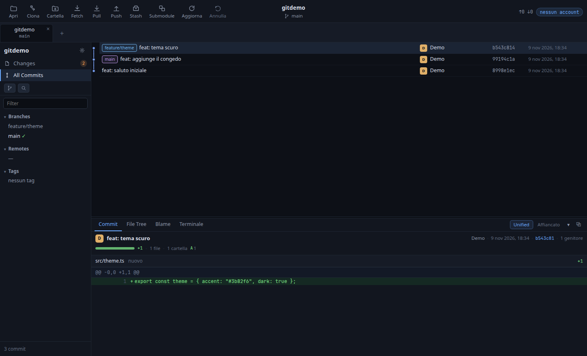
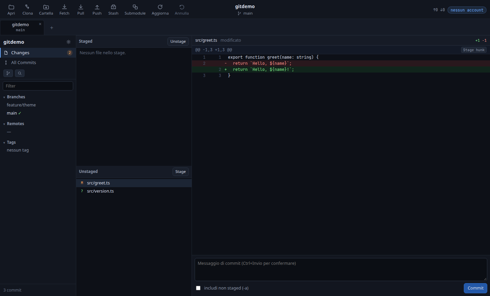

# GitHandler

[](https://github.com/emaxlele/githandler/actions/workflows/ci.yml)
[](LICENSE)
[](package.json)

English: [README.en.md](README.en.md)

Client Git desktop **Linux-first**, in TypeScript su Electron. Apre, **crea** o **clona** un
repository (da un URL o da un account GitHub / GitLab / Gitea / Bitbucket), mostra la storia con il
grafo, i diff, e copre il flusso quotidiano: stage (anche parziale), unstage, scarto, commit, checkout
di un ramo **o di un commit**, undo, pull, push, stash, merge, rebase, cherry-pick e submodule. Dal
repository si arriva **al file e alla cartella** — apri la posizione, apri il file, salva una copia,
apri repository e commit nel browser, esporta HEAD in uno zip — e il **token si prende dove c'è già**
(`gh`, credential helper) oppure **dal browser** con il device flow OAuth. Ogni repository ricorda con
quale account lavorare, i **fork** si sincronizzano con l'originale e le **GitHub Actions** si leggono,
si ri-eseguono e si annullano dall'app. Lo stesso repository è leggibile da un agente AI tramite un
server MCP, spento di default e abilitabile comando per comando.

Il nome: **`git`** davanti, perché è così che si cerca un client Git, e **handler** — chi maneggia il
repository. Il progetto si è chiamato `gitcraft` e, per poche ore dell'8 novembre 2026, `lanecraft` e
`gitlattice`.

Il codice è originale e clean-room: nessun codice, stringa, icona o asset preso da altri prodotti.

## Anteprima





## Stato (v0.10)

| Funzione                                                                                    | Stato          |
| ------------------------------------------------------------------------------------------- | -------------- |
| Apertura repository                                                                         | ✅             |
| **Creazione repository** (`git init`, identità locale)                                      | ✅             |
| **Clone da URL e da account** (4 provider)                                                  | ✅             |
| **Benvenuto all'avvio** (nessun dialog automatico)                                          | ✅             |
| **Azioni su file e cartella dal repository**                                                | ✅             |
| **Accesso dal browser (device flow OAuth)**                                                 | ✅             |
| **«Accedi» con il token già presente** (`gh`, credential helper)                            | ✅             |
| **Account scelto per repository** (chip nell'header)                                        | ✅             |
| **Fork: riconoscimento e sync con l'originale**                                             | ✅             |
| **GitHub Actions**: esecuzioni, riprova i falliti, ri-esecuzione, annulla                    | ✅             |
| **File del repository** (elenco filtrabile, browser)                                        | ✅             |
| **Esporta HEAD in uno zip**                                                                 | ✅             |
| Storia con grafo a corsie, paginata (2.000/pagina)                                          | ✅             |
| Rami, remoti, tag con ahead/behind                                                          | ✅             |
| Staging per file, unstage, scarto                                                           | ✅             |
| **Staging parziale per hunk e per riga**                                                    | ✅             |
| Diff unified e **affiancato** con intra-riga                                                | ✅             |
| Commit (anche `-a`), checkout di ramo e commit, nuovo ramo                                  | ✅             |
| Fetch                                                                                       | ✅             |
| **Pull** (`--ff-only`) e **push** (mai con forza)                                           | ✅             |
| **Stash** (salva anche solo alcuni file, applica, pop, elimina)                             | ✅             |
| **Merge, rebase, cherry-pick**, annulla operazione                                          | ✅             |
| **Pull request / merge request**: elenco e creazione da due rami                            | ✅             |
| **Conflitti risolti nell'app** (per file e per hunk, «continua»)                            | ✅             |
| **Interfaccia in italiano e in inglese**                                                    | ✅             |
| **Palette dei comandi** (`Ctrl+K`) e scorciatoie documentate                                | ✅             |
| **Submodule** (elenco e aggiornamento)                                                      | ✅             |
| **Terminale integrato** (nel repository attivo)                                             | ✅             |
| **Più repository aperti insieme** (schede)                                                  | ✅             |
| **Undo generale** (commit, checkout, scarto, merge)                                         | ✅             |
| **File non tracciati recuperabili** (oggetti Git)                                           | ✅             |
| **Ricerca nella storia**: testo, `author:`, `file:`, `regex:`, `change:`, `diff:`, `lines:` | ✅             |
| **Ricerca nel contenuto** dei file tracciati (`git grep`)                                   | ✅             |
| **Reflog** nell'app e «vai al commit» per SHA                                               | ✅             |
| **Controlli delle pull request** (esito e collegamenti)                                     | ✅             |
| **Notifiche CI dalla barra di sistema**                                                     | ✅             |
| **Salute del repository**: divergenti, stash vecchi, submodule, HEAD staccato                | ✅             |
| **Avanzamento di rete** (clone, fetch, pull, push)                                          | ✅             |
| **Temi** chiaro / scuro / OLED, densità e dimensione del testo                              | ✅             |
| **Aggiornamento automatico** (`--watch`)                                                    | ✅             |
| **Blame nella UI** (pannello virtualizzato)                                                 | ✅             |
| **Pannello ridimensionabile, a icona, in finestra**                                         | ✅             |
| **Server MCP con permessi configurabili**                                                   | ✅             |
| Syntax highlighting (CodeMirror 6)                                                          | ⏳ milestone 2 |
| **`.deb`** (Electron incluso, `npm run deb`)                                                | ✅             |
| Profilo AppArmor nel pacchetto                                                              | ⏳ milestone 4 |

## Interfaccia

La finestra segue la disposizione dei client Git desktop affermati, con tema chiaro, scuro o OLED
(scuro o nero assoluto), densità comoda o compatta e tre dimensioni del testo, scelti nelle
impostazioni:

-   **Toolbar** con le azioni etichettate (Apri, Clona, Cartella, Fetch, Pull, Push, Stash, Submodule,
    Aggiorna, Annulla) e, al centro, repository e ramo corrente. Sopra la storia ci sono le schede dei repository
    aperti, con la × per chiuderle e il `+` che apre la scelta _Apri / Crea / Clona da URL / Clona da un
    account_.
-   **Le schede si riaprono da sole**: all'avvio la finestra riprende i repository dell'ultima sessione,
    nello stesso ordine, e torna su quello che era attivo (`localStorage["githandler.sessions"]`). Un
    percorso sparito viene saltato senza fermare gli altri. `--repo <path>` apre quel repository in più e
    lo rende attivo.
-   **Benvenuto senza repository**: senza schede salvate la finestra non apre nessun dialog di sistema,
    mostra le quattro scelte e la cartella di base da cui partono i dialog e i cloni. Chiudendo l'ultima
    scheda si torna lì.
-   **Barra laterale**: nome del repository, _Changes_ con il conteggio, _All Commits_, filtro di
    ricerca e i ref divisi in Branches / Remotes / Tags. Il conteggio si nasconde a zero, è verde quando
    tutto è in stage e ambra quando resta qualcosa fuori.
-   **Notifiche CI senza tenere la finestra davanti**: l'icona nella barra di sistema ha «Mostra
    GitHandler», «Controlla adesso», l'interruttore delle notifiche e «Esci». Quando un'esecuzione
    dei workflow del repository attivo diventa un errore arriva un avviso, **una volta sola**; il
    primo controllo dopo l'apertura è una fotografia e non avvisa del passato. Solo GitHub, come la
    finestra delle esecuzioni.
-   **Reflog e salto a un commit**: «Reflog…» elenca gli spostamenti di HEAD (commit, checkout,
    reset, rebase) con selettore, SHA abbreviato e data; «Vai al commit» apre quel commit nel
    pannello. «Vai al commit per SHA…», dalla palette, raggiunge qualsiasi commit anche fuori dalla
    pagina di storia caricata. Nessuna delle due cambia il repository.
-   **Avanzamento delle operazioni di rete**: clone, fetch, pull e push leggono `stderr` di Git
    mentre lavorano e mostrano nella toolbar la fase (ricezione, risoluzione, invio), una barra e la
    percentuale; senza rete lenta la barra non serve, ma con un repository grande si vede che qualcosa
    sta succedendo.
-   **Ricerca con un linguaggio minimo**: il testo libero è letterale e non guarda le maiuscole;
    `author:` e `file:` filtrano autore e percorso; `regex:` cerca un'espressione regolare nel
    messaggio, `change:` i commit in cui cambia il numero di occorrenze di un testo (`-S`), `diff:` i
    commit il cui diff contiene una riga che corrisponde (`-G`), `lines:10,40:file` la storia di
    quell'intervallo di righe (`-L`, sul ramo corrente). La sintassi compare sotto il campo quando lo
    si apre.
-   **Ricerca nel contenuto** (`git grep`): un dialog a parte cerca nei file tracciati, con testo
    letterale o espressione regolare e l'opzione delle maiuscole; ogni risultato mostra file, riga e
    testo, e si apre nell'app del sistema. L'elenco si ferma a 1.000 corrispondenze e lo dice.
-   **Salute del repository…** (palette dei comandi): un controllo in sola lettura su rami divergenti
    (commit sia da inviare sia da ricevere), rami locali senza upstream, stash più vecchi di 30
    giorni, submodule non puliti e HEAD staccato. Non cambia niente: dice cosa guardare.
-   **Una vista sola per le modifiche**: la voce _Changes_ della barra laterale le porta a tutta area,
    senza storia né pannello inferiore: le liste Staged e Unstaged, il diff e il riquadro del commit.
    _All Commits_ riporta la storia.
-   **Storia** in cinque colonne: grafo a corsie, messaggio con i badge dei ref, autore con avatar a
    iniziali, SHA breve, data. Clic su un ramo o tag: il cursore va al suo commit. Tasto destro su un
    ramo: checkout, merge, rebase, rinomina, elimina, copia; su un commit: ramo nuovo da quel punto,
    merge, rebase, reset soft / mixed / hard, cherry-pick, copia di SHA e messaggio.
-   **Pannello inferiore** con quattro schede: `Commit` (una scheda con autore — e committer, quando è
    un altro — oggetto, data, SHA copiabile, genitori e una riga di analisi: barra proporzionale fra
    aggiunte e rimozioni, `+N`/`−M`, file, cartelle, binari e conteggio per stato; sotto, il diff
    dell'intero commit in un unico scorrimento, fino a 12 file e 4.000 righe), `File Tree` (albero dei
    file del commit o del working tree, diff a destra, l'unica vista file per file), `Blame` e
    `Terminale`. La maniglia sopra il pannello lo ridimensiona, `▾` lo riduce alla sola riga delle schede
    e `⧉` lo apre in una finestra separata: chiusa quella, il pannello torna al suo posto. Finché è
    separata, un chip «Dettagli ↗» nella toolbar la riporta davanti. Diff e albero scorrono, con la
    loro altezza vincolata al riquadro.

### Scorciatoie da tastiera

Ogni comando ha un nome e uno stesso punto di esecuzione: la palette (`Ctrl+K`) li cerca mentre si
scrive, le scorciatoie chiamano le stesse funzioni. `?` apre l'elenco dentro l'app.

| Tasto               | Cosa fa                                          |
| ------------------- | ------------------------------------------------ |
| `Ctrl+K`            | Palette dei comandi, con ricerca a sottosequenza |
| `Ctrl+O`            | Apre un repository dal disco                     |
| `Ctrl+F`            | Cerca nella storia                               |
| `Ctrl+R`, `F5`      | Rilegge il repository                            |
| `Ctrl+Z`            | Annulla l'ultima operazione                      |
| `Ctrl+1` … `Ctrl+4` | Pannello: commit, file, blame, terminale         |
| `Ctrl+Invio`        | Crea il commit con il messaggio scritto          |
| `?`                 | Elenco delle scorciatoie                         |
| `Esc`               | Chiude la finestra aperta o il menu              |

Nella palette le voci sono raggruppate (progetto, storia, rami e sincronizzazione, vista), si
scorrono con `↑`/`↓` e si eseguono con `Invio`. Un comando che non ha senso in quel momento — per
esempio «Annulla» senza niente da annullare — non compare.

### Dal repository al file

-   **Cartella** in toolbar: apre nel gestore file la cartella del repository attivo.
-   Tasto destro sulla **scheda del repository**: apri la cartella, copia il percorso, apri il repository
    nel browser (dall'URL di `origin`), chiudi la scheda.
-   Tasto destro su un **file** nel File Tree e doppio clic: apri con l'applicazione associata, mostra
    nella cartella, **salva una copia** fuori dal repository, copia il percorso. Da un commit la copia è
    la versione di allora, letta con `git show <sha>:<path>`: byte per byte, anche per i binari, con un
    tetto di 64 MiB oltre il quale l'app lo dice invece di troncare.
-   Tasto destro su un **commit**: _Apri il commit nel browser_, con l'URL del servizio (GitHub, GitLab,
    Bitbucket). Se il remoto non è un sito web il comando lo dice invece di aprire un indirizzo
    inventato.
-   I percorsi mandati dalla finestra sono verificati nel main: nessun `..`, nessun percorso assoluto,
    nessun nome che inizia con `-`.

Ogni funzione che esiste ha un comando, e ogni comando fa quello che dice: il terminale è una shell
vera nella cartella del repository, con il pulsante per interrompere il comando.

## Architettura

```
renderer (Chromium)   UI in DOM puro, zero framework, liste virtualizzate
        │  preload: contextBridge tipizzato
main (Node)           GitBackend → CliGitBackend (oggi)
        │
src/core              funzioni pure: parsing porcelain, layout del grafo, diff
```

Tre scelte che spiegano il resto:

-   **Il core è puro.** `src/core` non conosce Electron né il filesystem: si testa con `node --test`
    e, se servirà, si può estrarre in WASM dietro la stessa funzione.
-   **Le mutazioni passano dal binario `git`.** Hooks, Git LFS, credential helper, `core.autocrlf`,
    `skip-worktree`: nessuna libreria li replica davvero. `execFile` senza shell, con argomenti come
    array, quindi un path con spazi o apici non può diventare un comando.
-   **Niente ottimizzazioni premature.** Rust, WASM e `koffi`+libgit2 sono dietro un'interfaccia e
    arrivano solo se una misura supera una soglia: i numeri e le soglie stanno in
    [`docs/backend-performance.md`](docs/backend-performance.md).

Il quadro completo — regole, contratti fra i tre livelli, costi misurati e trappole Linux — è in
[`docs/architettura.md`](docs/architettura.md), scritto per essere riusato in altri progetti desktop.

## Comandi

```bash
npm install
npm start                              # build + avvio
npm start -- --repo ~/Projects/AI_Knowledge --watch   # rilegge il repo quando cambia

npm test                  # parser, grafo e integrazione con git vero
npm run typecheck
npm run build             # dist/main, dist/preload, dist/renderer, dist/mcp
npm run dev               # rebuild continuo dei bundle
npm run bench             # misure del backend (log, parsing, grafo, status)
npm run mcp -- --repo .   # server MCP su stdio, lettura e scrittura (vedi docs/mcp.md)
```

Flag di avvio: `--repo <path>`, `--watch` (sorveglianza del repository, o `GITHANDLER_WATCH=1`),
`--no-watch` per spegnerla quando è attiva per ambiente.

## Installazione (Ubuntu)

Due strade.

**Pacchetto `.deb`**, con il runtime Electron incluso, senza dipendenze npm a runtime:

```bash
npm run deb
sudo apt install ./release/githandler_0.10.0_amd64.deb
```

Installa l'app in `/opt/githandler`, il launcher in `/usr/bin/githandler`, la voce nel menu e
l'icona. Su Ubuntu 24.04+ il launcher aggiunge `--no-sandbox` quando manca il profilo AppArmor; il
profilo dedicato è il lavoro di packaging ancora aperto (milestone 4).

**Installazione nel profilo utente**, senza sudo e senza pacchetto:

```bash
./build/install-local.sh
```

Lo script compila i bundle e scrive launcher, voce nel menu e icona:

| Cosa          | Dove                                                        |
| ------------- | ----------------------------------------------------------- |
| Launcher      | `~/.local/bin/githandler`                                   |
| Voce nel menu | `~/.local/share/applications/githandler.desktop`            |
| Icona         | `~/.local/share/icons/hicolor/scalable/apps/githandler.svg` |

Il launcher ricompila con esbuild a ogni avvio, così il menu apre sempre il codice corrente:
`githandler --repo ~/Projects/AI_Knowledge`. Per AppArmor su Ubuntu il sandbox di Chromium resta
spento (`--no-sandbox`).

## API per l'AI

`dist/mcp/index.js` è un server MCP su stdio che può esporre cinque tool di **lettura**
(`repo_status`, `history`, `show_commit`, `worktree_diff`, `blame`) e cinque di **scrittura**
(`stage`, `unstage`, `commit`, `create_branch`, `checkout_branch`). Usa lo stesso backend della UI:
ogni modifica compare nell'app e resta annullabile.

**I permessi si decidono nell'app**, non nel file di configurazione del client: _Impostazioni → API
per l'AI_. Il default è **spento**; si può abilitare tutto, solo la lettura, o scegliere i singoli
comandi. La sola lettura non espone mai un comando che scrive. Il server rilegge la policy a ogni
richiesta, quindi un client già collegato smette di vedere i tool appena li si toglie. Ogni chiamata
che scrive lascia una riga in `.git/githandler/mcp-audit.jsonl`, con argomenti ridotti ed esito, che
ruota a 1 MiB. La policy vive in `$XDG_CONFIG_HOME/githandler/settings.json` (override con
`GITHANDLER_CONFIG_DIR`) ed è la stessa per UI e MCP. Configurazione per OpenCode, Claude e limiti in
[`docs/mcp.md`](docs/mcp.md).

## Account collegati e credenziali

GitHub, GitLab, Gitea/Forgejo e Bitbucket. L'account serve a **elencare i repository** dell'utente e a
**clonare** anche quelli privati; per Gitea/Forgejo e per le installazioni proprie si cambiano host e
indirizzo dell'API.

-   In `$XDG_CONFIG_HOME/githandler/accounts.json` (permessi `0600`) stanno **solo i metadati**:
    provider, host, API, utente, etichetta e, se lo usi, il Client ID OAuth (pubblico per definizione).
-   Il **token non lo scrive l'app**: resta in memoria per la sessione e arriva a `git` tramite
    `GIT_ASKPASS` (script generico in `~/.config/githandler/askpass.sh`, `0700`, che legge utente e
    token dall'ambiente del processo figlio). Se hai un credential helper configurato, il token viene
    anche consegnato con `git credential approve`: lo conserva Git, nel suo archivio, non GitHandler.
-   Le credenziali valgono per clone, fetch, pull e push: l'host si ricava da `origin`.
-   Il token si **cambia** dall'account in qualsiasi momento; un rifiuto dell'API diventa un messaggio
    che dice di aggiornarlo. Rimuovere l'account lo dimentica, ma non cancella quello che ha salvato Git.
-   All'avvio l'app **ricerca da sola** i token già presenti sulla macchina (`hydrateTokens`): prima il
    credential helper, chiesto per quell'utente, poi `gh auth token` — quest'ultimo solo se su quell'host
    c'è **un solo account**, perché GitHub CLI ne tiene uno per host e con due utenti il token sarebbe
    ambiguo. Chiudere e riaprire non richiede quindi di rifare _Accedi_. Un esito negativo si ricorda per
    la sessione, così un'operazione senza token non riapre un helper grafico ogni volta.

### Il token: prima dove c'è già, poi dal browser

-   **Accedi con il token del computer** è un clic: l'app cerca un token già presente sulla macchina —
    `gh auth token --hostname <host>` (GitHub CLI), poi il credential helper di Git (`git credential
fill`) — lo verifica con `GET /user` e salva l'account. Nessun Client ID da incollare.
-   Se un token non c'è, resta **Accedi con il browser (serve il Client ID)**: il _device flow_ OAuth di
    GitHub e GitLab
    (anche installazioni proprie). Il device flow **richiede un Client ID registrato** — non esiste un
    flusso anonimo — e l'app lo mostra per quello che è: un dato pubblico, salvato accanto agli altri
    dati dell'account. Il pulsante _Crea…_ apre la pagina dove registrarlo; per GitHub il device flow va
    abilitato su quell'applicazione.
-   In entrambi i casi il token lo riceve il main, che legge il nome dell'utente e salva l'account; alla
    finestra tornano solo l'esito e l'id dell'account.
-   Per Gitea e Bitbucket, che non hanno il device flow, resta **Crea un token sul sito e incollalo…**:
    apre la pagina dei token del provider, con gli scope già indicati dove il provider li accetta.
-   Pulsanti e voci dei menu hanno un suggerimento (`title`) che spiega cosa fanno; i menu contestuali
    lo mostrano su ogni voce prima di sceglierla.

### Con quale account lavora un repository

Il remoto dice l'host, non l'account con cui è stato clonato. Le regole, dalla più forte alla più
debole: la **scelta salvata** per quel repository; un account dello stesso host il cui utente è il
**proprietario** del remoto; l'**unico** account dell'host; il **primo** di più account. L'ultimo caso
è una supposizione e il **chip nell'header** lo dichiara: clic per scegliere un altro account o togliere
la scelta. Fetch, pull, push e clone usano quell'account.

La **cartella di base** (Impostazioni) è il punto di partenza di «Apri», «Crea» e «Clona» e la
destinazione predefinita dei cloni; non è un limite, dalla finestra di scelta si naviga ovunque.

## Fork, pull request e GitHub Actions

Dal menu del tasto destro sulla scheda del repository:

-   **Sincronizza con l'originale (merge/rebase)**: l'app chiede al provider qual è il repository
    originale, crea il remoto `upstream` la prima volta, poi `fetch` e `merge`/`rebase` del ramo
    predefinito. Niente forza: un conflitto resta annullabile. Con HEAD staccato il sync si ferma e lo
    dice.
-   **Pull request…**: le richieste aperte sul servizio del repository (GitHub, GitLab, Gitea/Forgejo,
    Bitbucket), con autore, ramo di partenza e di arrivo, stato di bozza e _Apri_ nel browser. Dalla
    stessa finestra se ne crea una da due rami: i rami devono essere già stati inviati con Push. Su
    GitLab la finestra si chiama _merge request_. Non serve un token nuovo: usa l'account già scelto
    per il repository. _Controlli_ legge l'esito dei workflow sul commit in testa alla richiesta —
    verde, rosso o in corso, con il dettaglio e il collegamento a ciascuno.
-   **GitHub Actions…**: ultime esecuzioni con workflow, stato, ramo ed evento; _Riprova i falliti_
    (solo i job rossi, dopo un fallimento), _Ri-esegui_ (l'intero workflow), _Annulla_ (una in corso),
    _Apri_ nel browser. Solo GitHub.
-   **Apri un file del repository…**: elenco filtrabile dei file tracciati in HEAD, apertura dal sistema
    o nel browser (Gitea compreso).
-   **Esporta HEAD in un archivio zip…**: `git archive`, quindi `export-ignore` e i filtri del
    repository valgono; non-tracciati e modifiche non committate restano fuori.

## File non tracciati scartati

Git non può annullare la cancellazione di un file che non ha mai tracciato. Prima di cancellarlo
l'app ne scrive i byte come **oggetti Git**: un blob per file, un albero e un commit raggiungibile da
`refs/githandler/trash/<scope>/<id>`. `Annulla` li ripristina come gli altri, compresi cartelle
annidate, link simbolici, permesso eseguibile e contenuto binario.

-   La copia è attiva di default e si spegne dalle impostazioni.
-   Limiti modificabili: **25 MB e 2.000 file per operazione**, **5 GB in totale**. Oltre il limite
    di una singola operazione lo scarto si ferma e lo dice; quando lo spazio totale è pieno si
    eliminano per prime le copie più vecchie, mai quella appena creata.
-   I ref stanno in un namespace separato (`refs/githandler/*`): non compaiono nella storia, non
    entrano in `log --all` e non vengono inviati al remoto.
-   Un sotto-repository annidato viene conservato per intero, cartella `.git` compresa.
-   Se nel frattempo è stato ricreato un file con lo stesso nome, il ripristino non sovrascrive: si
    ferma e chiede di spostarlo.
-   Gli oggetti non più raggiungibili vengono recuperati dal normale `git gc` del repository: l'app
    non forza mai una potatura che cancellerebbe anche i commit orfani dell'utente.

Nel dubbio fra perdere spazio e perdere dati, l'app sceglie lo spazio: la quota è una rete di
sicurezza, non un limite da riempire.

## Note su Linux

-   **AppArmor**: su Ubuntu 24.04+ (`kernel.apparmor_restrict_unprivileged_userns=1`) il sandbox di
    Chromium non parte. In sviluppo serve `--no-sandbox` o un profilo AppArmor nel pacchetto: è
    previsto nel lavoro di packaging (milestone 4).
-   **GPU**: il processo GPU di Chromium non è disponibile su tutte le macchine. Per un'app testuale
    il rendering software è invisibile, quindi è il default; `GITHANDLER_GPU=1` riattiva
    l'accelerazione.
-   **Screenshot senza display**: `npm run shots -- --repo .` (guida la UI e salva i PNG).

## Licenza

**GPL-3.0-or-later** — vedi [`LICENSE`](LICENSE). Copyright © 2026 emaxlele.

Il progetto è software libero: puoi usarlo, studiarlo, modificarlo e ridistribuirlo secondo i termini
della licenza. Se distribuisci una versione modificata, devi pubblicarne il sorgente con la stessa
licenza, quindi nessuno può chiudere questo lavoro e rivenderlo come prodotto proprietario.

Per contribuire leggi [`CONTRIBUTING.md`](CONTRIBUTING.md); per i problemi di sicurezza
[`SECURITY.md`](SECURITY.md); per la direzione del progetto [`ROADMAP.md`](ROADMAP.md).

GitHandler è un progetto indipendente: non è affiliato, approvato o sponsorizzato da GitHub, GitLab,
Gitea, Bitbucket o da altri prodotti. Quei nomi servono solo a descrivere l'interoperabilità.
